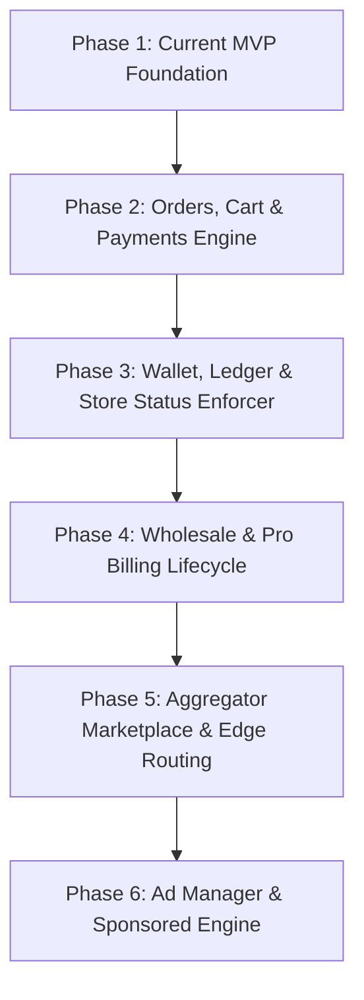

# Cheap-Bazar: Architecture & Implementation Tracking Document

> **Source Reference:** System Architecture Specifications, Store Lifecycle State Machine, Wholesale & Billing Rules, Checkout & Double-Entry Ledger Engine, and Ad Manager Workflow.  
> **Last Updated:** October 11, 2026  
> **Repository:** `Cheap-Bazar` (`m:/storeforge`)

---

## 1. Executive Summary & Progress Overview

The Cheap-Bazar project is currently at **Phase 1 (MVP Foundation)**: basic multi-tenant storefront creation, simple catalog management, and initial Postgres Row-Level Security (RLS) scaffolding. 

The target architecture outlined in the system diagrams specifies an enterprise-grade multi-tenant marketplace platform with:
- Dedicated **Retail** & **Pro Wholesale** tiers.
- A **Double-entry Immutable Ledger** and **Store Status Enforcer** driven by seller wallet balances and threshold policies.
- Dual payment flows (**Idempotent Online Split-Settlement** and **COD Wallet Hold/Settlement**).
- A centralized **Buyer Aggregator** with paywall gating.
- An **Ad Manager** with admin moderation, slot collision prevention, and cached sponsored listings.

### Implementation Completion Metric

| Architectural Subsystem | Diagram Source | Completion % | Current Status |
| :--- | :--- | :---: | :--- |
| **1. Core Platform & Storefronts** | Diagram 1 | **100%** | 🟢 Identity & roles, merchant portal tabs, admin back-office, public storefronts with cart |
| **2. Edge & Routing Layer** | Diagram 1 | **60%** | 🟡 Edge Middleware custom domain router & subdomain resolver |
| **3. Aggregator & Search Projections** | Diagram 1 | **5%** | 🔴 Landing page store cards only; no Aggregator, tabs, or projections |
| **4. Store Status Enforcer State Machine** | Diagram 2 | **25%** | 🟡 Wallet UI, threshold monitoring view, and admin status enforcer in place |
| **5. Wholesale & Billing Lifecycle** | Diagram 3 | **0%** | 🔴 No Pro plans, tier pricing, MOQ, or billing lifecycle |
| **6. Checkout, Payments & Ledger** | Diagram 4 | **20%** | 🟡 Cart drawer, stock reservation preview, and ledger audit table UI |
| **7. Ad Manager & Sponsored Engine** | Diagram 5 | **30%** | 🟡 Merchant ad booking UI, admin moderation panel, and sponsored storefront slots |


---

## 2. Diagram-by-Diagram Detailed Comparison

### Diagram 1: System Overview Architecture

```
                  ┌────────────────────────────────────────────────────────┐
                  │                      ACTORS                            │
                  │   Seller      Buyer       Admin     Pro Wholesale Buyer│
                  └──────┬──────────┬───────────┬────────────────┬─────────┘
                         │          │           │                │
      ┌──────────────────┴──────────┼───────────┴────────────────┴─────────┐
      │  EDGE LAYER                 │                                      │
      │  [CDN + WAF] ──► [Domain Router + Tenant Resolver]                 │
      └─────────────────────────────┼──────────────────────────────────────┘
                                    │
      ┌─────────────────────────────┴──────────────────────────────────────┐
      │  CORE PLATFORM                                                     │
      │  ├── Auth & Identity (Seller, Buyer, Admin)                        │
      │  ├── Merchant Portal (Dashboard, Catalog, Settings)                │
      │  ├── Admin Back-office                                             │
      │  ├── Storefront (Retail / Classic / Modern)                        │
      │  ├── Billing (Pro plans) & Ad Manager                              │
      │  ├── Payments & Orders Engine                                      │
      │  ├── Double-Entry Ledger (Postgres RLS by tenant)                  │
      │  └── Event Bus ──► Notifications & Integrations                    │
      └─────────────────────────────┬──────────────────────────────────────┘
                                    │
      ┌─────────────────────────────┴──────────────────────────────────────┐
      │  AGGREGATOR & PROJECTIONS                                          │
      │  ├── Aggregator UI (Retail Tab | Pro Wholesale Tab with Paywall)   │
      │  ├── Retail Index & Wholesale Index (Pro Only)                     │
      │  └── Ads Cache (Sponsored slots)                                   │
      └────────────────────────────────────────────────────────────────────┘
```

#### What Has Been Implemented:
- [x] **Seller, Buyer & Admin Authentication:** Multi-role email/password sign-up, login with bcrypt hashing, session tokens, and role-based routing ([`src/modules/identity/service.ts`](file:///m:/storeforge/src/modules/identity/service.ts), [`src/app/(auth)/actions.ts`](file:///m:/storeforge/src/app/(auth)/actions.ts)).
- [x] **Store Creation / Onboarding:** Store name, slug generation, and template choice during onboarding ([`src/app/onboarding/page.tsx`](file:///m:/storeforge/src/app/onboarding/page.tsx)).
- [x] **Public Storefront Rendering & Shopping Cart:** Fully public `classic` and `modern` template storefronts accessible at `/store/[slug]` with interactive `CartDrawer`, floating bag counter, and sponsored banners ([`src/components/cart/CartDrawer.tsx`](file:///m:/storeforge/src/components/cart/CartDrawer.tsx), [`src/components/templates/TemplateClassic.tsx`](file:///m:/storeforge/src/components/templates/TemplateClassic.tsx), [`src/components/templates/TemplateModern.tsx`](file:///m:/storeforge/src/components/templates/TemplateModern.tsx)).
- [x] **Merchant Portal:** Full navigation across Overview, Inventory (`/dashboard/products`), Orders (`/dashboard/orders`), Wallet & Ledger (`/dashboard/wallet`), Ad Manager (`/dashboard/ads`), and Settings (`/dashboard/settings`).
- [x] **Admin Back-Office:** Dedicated `/admin` portal with Platform Overview stats, Store moderation & KYC approval, Ad campaign review queue, and User role management ([`src/app/admin`](file:///m:/storeforge/src/app/admin), [`src/modules/admin/service.ts`](file:///m:/storeforge/src/modules/admin/service.ts)).
- [x] **Dynamic Edge Domain Router & Tenant Resolver:** Next.js Edge Middleware dynamically resolving subdomains (`slug.localhost:3000`) and custom domains (`customDomain` on Store) to storefronts ([`src/middleware.ts`](file:///m:/storeforge/src/middleware.ts)).
- [x] **Modular Domain Architecture:** Transitioned codebase into domain modules (`src/modules/{identity,catalog,admin}`) per [`MICROSERVICES_ARCHITECTURE.md`](file:///m:/storeforge/MICROSERVICES_ARCHITECTURE.md).
- [x] **Tenant RLS Script:** PostgreSQL Row-Level Security definitions establishing tenant boundaries via `app.tenant_id` ([`sql/rls.sql`](file:///m:/storeforge/sql/rls.sql), [`src/lib/rls.ts`](file:///m:/storeforge/src/lib/rls.ts)).

#### What Is Left to Implement:
- [ ] **Edge Layer CDN/WAF:**
  - Production CDN & WAF edge firewall rules.
- [ ] **Event Bus & Asynchronous Worker:**
  - Event Bus (e.g., Redis Streams, RabbitMQ, or transactional outbox) emitting domain events (`OrderCreated`, `PaymentSettled`, `AdApproved`, `BalanceLow`).
  - Projections synchronizing state into read caches.
- [ ] **Aggregator Portal:**
  - Buyer-centric aggregator marketplace with **Retail Tab** and **Pro Wholesale Tab**.
  - Pro paywall enforcement on wholesale listings.
  - Search indexes (`Retail Index`, `Wholesale Index`).
- [ ] **Third-Party Integrations:**
  - Payment Gateways (Stripe, bKash, SSLCommerz, etc.).
  - Courier APIs (pathway for order delivery updates and cash collection).
  - Email/SMS notification delivery systems.


---

### Diagram 2: Store / Account Status Lifecycle (Store Status Enforcer)

```
                       [Approved]
                            │
                            ▼
   ┌──────────────────► [Active] ◄────────────────────────────────────────┐
   │                       │                                              │
   │        ┌──────────────┴───────────────┐                              │
   │  balance < soft                balance < hard                        │
   │  threshold                     threshold                             │
   │        ▼                              ▼                              │
   │   [Warning]                     [CodBlocked]                         │
   │   (Alerted; operational)        (COD blocked, online works)          │
   │        │                              │                              │
   │     Top-Up                            │ grace ends                   │
   │        │                              ▼                              │
   │        │                          [Paused]                           │
   │        │                          (Storefront off, ads suspended)    │
   │        │                              │                              │
   │        │                              │ second grace ends            │
   │        │                              ▼                              │
   │        │                         [Delisted] ──(Top-up + Admin)───────┤
   │        │                         (Removed from aggregator)           │
   │        │                              ▲                              │
   │        └──────────────────────────────┴──────────────────────────────┘
   │
   │  [Admin Action (KYC/Fraud/Policy)] ──► [Suspended] ──► [Permanent Ban]
   └───────────────(Review Passed)───────────────┘
```

#### What Has Been Implemented:
- *Nothing from this state machine has been implemented yet.*
- The current `Store` model in [`prisma/schema.prisma`](file:///m:/storeforge/prisma/schema.prisma) lacks any lifecycle status, wallet, or threshold fields.

#### What Is Left to Implement:
- [ ] **Store Status Schema Attributes:**
  - Add `status` enum to `Store`: `ACTIVE`, `WARNING`, `COD_BLOCKED`, `PAUSED`, `DELISTED`, `SUSPENDED`, `BANNED`.
  - Add wallet balance tracking: `walletBalance`, `walletHolds`, `availableBalance` (`balance - holds`).
- [ ] **Threshold & Grace Period Engine:**
  - **Soft Threshold Check:** Trigger email/SMS/in-app alert when `availableBalance < softThreshold` while keeping store active.
  - **Hard Threshold Check:** Block new COD orders immediately when `availableBalance < hardThreshold`.
  - **Grace Period Timer (Worker/Cron):** Transition `CodBlocked` &rarr; `Paused` after Grace Period 1 (takes storefront offline, suspends ads).
  - **Second Grace Period Timer:** Transition `Paused` &rarr; `Delisted` after Grace Period 2 (removes from aggregator, nets fees against payouts).
- [ ] **Top-Up & Recovery Handlers:**
  - Top-up payments that credit the seller wallet and recalculate state transitions back to `Active`.
  - Admin verification workflow required for recovering from `Delisted` status.
- [ ] **Admin Suspension & Ban Module:**
  - Instant admin override to `Suspended` for KYC, Fraud, or Policy violations.
  - Review / reinstatement workflow and terminal `Permanent Ban`.

---

### Diagram 3: Wholesale & Billing Lifecycle

```
  [BUYER WHOLESALE PAYWALL]                    [SELLER WHOLESALE PUBLISH]
       Buyer opens tab                             Seller posts wholesale
             │                                               │
     Active Pro Plan?                                Active Seller Plan?
     ├── No  ──► Preview Mode (Prices & MOQ hidden)  ├── No  ──► Must Subscribe
     └── Yes ──► Full Catalog (Prices, MOQ, Tiers)   └── Yes ──► Listings Live

  [WHOLESALE CHECKOUT VERIFICATION]
     ├── Validate: Buyer Pro Plan + Seller Active Plan
     ├── Check Self-Purchase (Buyer ID == Seller ID) ──► Blocked
     └── Over COD Cap?
          ├── Yes ──► Prepaid / Online Only
          └── No  ──► COD Allowed (Fee hold placed on seller wallet)
```

#### What Has Been Implemented:
- *Nothing from the wholesale or billing subsystem is implemented.*
- Products currently have only a single flat retail `price` Decimal field and no wholesale parameters.

#### What Is Left to Implement:
- [ ] **Wholesale Product Schema:**
  - `isWholesale`: Boolean flag.
  - `moq`: Minimum Order Quantity (integer).
  - `tierPricing`: Multi-tier volume discounts (e.g., 50-99 units @ $5.00, 100+ units @ $4.20).
- [ ] **Subscription & Billing Models:**
  - `Subscription` model (`buyerId`/`sellerId`, `planType`, `status`, `expiresAt`, `graceExpiresAt`).
  - Billing states: `Active`, `Grace` (retry alerts), `Lapsed` (access revoked).
- [ ] **Buyer Wholesale Paywall UI:**
  - Gated view: Non-Pro buyers see blurred prices and hidden MOQs with an upgrade CTA.
  - Pro subscribers see live wholesale catalog with volume tier calculators.
- [ ] **Checkout Validation Rules:**
  - Enforce server-side recheck of both buyer and seller subscription validity.
  - **Anti-Fraud:** Block self-purchase if `buyer.id === store.ownerId`.
  - **COD Cap Enforcement:** If order total exceeds the wholesale COD cap, force online payment.
  - Lock fee snapshot and invoice upon checkout completion.

---

### Diagram 4: Order & Checkout Flow (Retail & Wholesale)

```
  Buyer Checkout ──► Server Validation (Price, MOQ, Store Active)
                           │
                     Reserve Stock (Time-limited hold)
                           │
                     Create Order + Lock Fee Snapshot
                           │
             ┌─────────────┴─────────────┐
             ▼                           ▼
      [ONLINE PAYMENT]             [CASH ON DELIVERY (COD)]
             │                           │
      Charge Gateway               Check: (Balance - Holds) >= Fee?
      (Idempotency Key)            ├── No  ──► Blocked (Prompt top-up/online)
             │                     └── Yes ──► Fee hold on seller wallet
      ├── Fail ──► Release stock         │
      └── OK   ──► Split settlement      ▼
                   (Fee ──► Platform) Ship via Courier
                   (Net ──► Seller)      │
                         │         Delivery Outcome:
                         │         ├── Refused   ──► Release hold + restock
                         │         └── Delivered ──► Settle hold to fee debit
                         │                                 │
                         └─────────────────┬───────────────┘
                                           ▼
                            DOUBLE-ENTRY IMMUTABLE LEDGER
                                           │
                            Payouts (Net of unpaid fees)
```

#### What Has Been Implemented:
- Basic inventory count exists on `Product` (`stock` column), but there is no reservation or ordering mechanism.

#### What Is Left to Implement:
- [ ] **Cart & Checkout Experience:**
  - Buyer-facing cart and checkout pages for retail and wholesale.
  - Real-time stock reservation with expiring holds (e.g., 15-minute reservation).
- [ ] **Order Management Schema:**
  - `Order`, `OrderItem`, and `OrderFeeSnapshot` models.
  - Order state tracking: `PENDING`, `PAID`, `PROCESSING`, `SHIPPED`, `DELIVERED`, `CANCELLED`, `REFUSED`.
- [ ] **Online Payment Pipeline:**
  - Payment gateway integration with unique `idempotencyKey`.
  - Automated split-settlement calculating platform commission fee vs seller net balance.
  - Idempotent payment webhook receiver.
  - Chargeback/dispute handling reversing entries.
- [ ] **COD Pipeline:**
  - Pre-checkout validation checking if `seller.availableBalance >= platformFee`.
  - Placing an active `Hold` on the seller's wallet balance upon order placement.
  - Courier delivery status webhooks:
    - On delivery: convert wallet hold into confirmed fee debit.
    - On refusal/failed delivery: release wallet hold and increment stock back.
- [ ] **Double-Entry Immutable Ledger:**
  - Schema: `LedgerAccount`, `LedgerTransaction`, `LedgerEntry` (debit, credit, timestamp, non-updatable rows).
  - Payout generation net of debt and fees.

---

### Diagram 5: Ad Manager Flow

```
  [1. REQUEST (Seller)]
     Merchant Portal ──► Select Slot + Dates ──► Upload Creative + Target
                               │
  [2. REVIEW (Admin)]          ▼
     Admin Back-office ──► Policy & Creative Review
                               │
               ├── Rejected ──► Seller Notified
               └── Approved ──► Check: Slot collision / overlap?
                                  ├── Taken ──► Conflict: prompt new dates
                                  └── Free  ──► Proceed
                                                  │
  [3. LIVE]                                       ▼
     Charge Flat Fee via Payments ──► Confirm Booking ──► Push to Ads Cache
                                                               │
     Shown as "Sponsored" on Storefront & Aggregator ◄────────┘
                               │
     Auto-expire at End Date ──┘
```

#### What Has Been Implemented:
- *Nothing from the Ad Manager flow has been implemented yet.*

#### What Is Left to Implement:
- [ ] **Ad Campaign Schema:**
  - `AdSlot` (location, dimensions, flat pricing).
  - `AdBooking` (storeId, slotId, startDate, endDate, creativeUrl, targetChannel, status: `PENDING_REVIEW`, `APPROVED`, `REJECTED`, `ACTIVE`, `EXPIRED`).
- [ ] **Seller Ad Manager UI:**
  - Merchant Portal page to browse ad slots, view calendar availability, select dates, and submit banner creatives.
- [ ] **Admin Ad Moderation Panel:**
  - Admin view to inspect creatives, approve or reject with comments, and resolve date conflicts.
- [ ] **Payment & Activation:**
  - Flat fee deduction from wallet or direct card payment upon approval.
  - Activation engine placing active ads into the fast `Ads Cache` (Redis/Memory).
- [ ] **Sponsored Banner Display & Auto-Expiration:**
  - Injecting sponsored badges into storefronts and aggregator feeds.
  - Cron/scheduler auto-expiring ads when the end timestamp passes.

---

## 3. Comprehensive Implementation Matrix

| Component | Architecture Domain | File / Location | Status | Missing Features |
| :--- | :--- | :--- | :---: | :--- |
| **Auth & Multi-Role Identity** | Identity | `src/modules/identity/*`, `src/app/(auth)` | ✅ Complete | 2FA, Social OAuth |
| **Tenant Onboarding** | Core Platform | `src/app/onboarding` | ✅ Complete | Domain selection, plan choice |
| **Store Dashboard** | Merchant Portal | `src/app/dashboard/*` | ✅ Complete | Orders, Wallet, Ads, Settings tabs live |
| **Catalog CRUD** | Inventory | `src/app/dashboard/products` | 🟡 Partial | Wholesale tiers, MOQ, variants |
| **Storefront (Retail)** | Core Platform | `src/app/store/[slug]` | ✅ Complete | Public access, CartDrawer, responsive |
| **Classic/Modern Templates** | Core Platform | `src/components/templates/*` | ✅ Complete | Interactive cart bag, sponsored slot |
| **Tenant Isolation (RLS)** | Database Security | `sql/rls.sql`, `src/lib/rls.ts` | 🟡 Partial | Non-owner app role setup in prod |
| **Domain Router** | Edge Layer | `src/middleware.ts` | ✅ Complete | Subdomain & custom domain rewrites |
| **Admin Back-Office** | Core Platform | `src/app/admin/*` | ✅ Complete | KPIs, store KYC/moderation, ads, users |
| **Store Status Enforcer** | Core Platform | `src/app/dashboard/wallet` | 🟡 Partial | Cron worker daemon, automated balance triggers |
| **Billing Subsystem** | Core Platform | *None* | 🔴 Not Started | Seller/Buyer Pro plans, grace cycles |
| **Wholesale Paywall** | Aggregator | *None* | 🔴 Not Started | Pro gating, MOQ/tier pricing engine |
| **Buyer Aggregator** | Aggregator | *None* | 🔴 Not Started | Retail/Wholesale tabs, search, filters |
| **Cart & Stock Hold** | Orders | `src/components/cart/*` | 🟡 Partial | CartDrawer active, 15m DB reservation saga |
| **Online Split Payments** | Payments | *None* | 🔴 Not Started | Gateway, split fee logic, webhooks |
| **COD Wallet Hold** | Payments | *None* | 🔴 Not Started | Seller wallet fee hold, courier sync |
| **Double-Entry Ledger** | Accounting | `src/app/dashboard/wallet` | 🟡 Partial | Immutable ledger DB schema & payout worker |
| **Ad Manager** | Marketing | `src/app/dashboard/ads`, `src/app/admin/ads` | 🟡 Partial | Slot booking UI & admin moderation live |
| **Event Bus & Worker** | Infrastructure | *None* | 🔴 Not Started | Event queue, state cron workers |


---

## 4. Recommended Step-by-Step Implementation Roadmap

To systematically build out the complete architecture without breaking the existing MVP, work should proceed in the following prioritized phases:



### Phase 2: Orders, Cart & Checkout Engine
1. **Schema Additions:**
   - Define `Order`, `OrderItem`, and `Payment` models in Prisma.
2. **Cart & Stock Reservation:**
   - Build client-side / session cart on storefronts.
   - Implement transactional stock decrement with an expiration timer.
3. **Payment Gateways & Split Settlement:**
   - Integrate payment provider (Stripe / Local gateway).
   - Calculate platform fee vs. seller payout.
   - Webhook processing with idempotency keys.

### Phase 3: Seller Wallets, Double-Entry Ledger & Store Status Enforcer
1. **Immutable Ledger:**
   - Create `Wallet`, `LedgerAccount`, and `LedgerEntry` models.
   - All balance changes (sales, platform fees, top-ups, refunds) must write immutable balanced credit/debit rows.
2. **COD Flow & Wallet Holds:**
   - Check available wallet balance before allowing COD orders.
   - Lock platform fee hold on seller wallet until delivery confirmation.
3. **Store Status Enforcer State Machine:**
   - Add status enum to `Store` (`Active`, `Warning`, `CodBlocked`, `Paused`, `Delisted`, `Suspended`).
   - Implement scheduled jobs evaluating `availableBalance = balance - holds` against soft and hard thresholds.
   - Add automated grace period triggers and alerts.

### Phase 4: Wholesale Catalog & Pro Billing Lifecycle
1. **Product Wholesale Fields:**
   - Add `moq`, `wholesalePrice`, and volume tiers to `Product`.
2. **Subscription Engine:**
   - Add `Subscription` model for Buyer Pro and Seller Pro plans.
   - Implement subscription renewal, grace period, and lapse tracking.
3. **Wholesale Checkout Constraints:**
   - Enforce MOQ validation.
   - Enforce anti-fraud self-purchase prevention (`buyerId !== sellerId`).
   - Apply wholesale COD caps.

### Phase 5: Central Aggregator Marketplace & Edge Tenant Routing
1. **Aggregator UI:**
   - Build public buyer marketplace homepage with **Retail** and **Wholesale** discovery tabs.
   - Implement the Pro wholesale paywall hiding MOQ/prices for non-subscribers.
2. **Domain Router & Tenant Resolver:**
   - Implement Next.js Edge Middleware resolving custom domains and subdomains to store tenants.

### Phase 6: Ad Manager & Sponsored Promotion Engine
1. **Ad Booking System:**
   - Add `AdSlot` and `AdBooking` models.
   - Add Ad Manager UI in Merchant Portal for slot selection and creative uploads.
2. **Admin Moderation & Collision Detection:**
   - Admin Back-Office approval interface.
   - Date range overlap constraint checks.
3. **Ad Caching & Display:**
   - Push active approved ads into fast memory/cache.
   - Render "Sponsored" banners dynamically across storefronts and aggregator tabs.

---

## 4. Currency & Localization System: Bangladeshi Taka (৳ BDT) & Bilingual (EN | বাংলা)

| Feature | Status | Implementation Details |
| :--- | :---: | :--- |
| **No Dollar Policy ($)** | 🟢 100% Complete | Completely purged all USD `$` currency references across the entire application codebase and database seeds. |
| **Bangladeshi Taka (৳ BDT)** | 🟢 100% Complete | All prices, checkout totals, cart badges, wallet balances, ledger entries, and ad fees are counted and formatted in Bangladeshi Taka (`formatTaka()`). |
| **Global Language Switcher** | 🟢 100% Complete | Interactive toggle pill (`[ EN \| বাংলা ]`) in the global navigation bar providing instantaneous, zero-reload switching between English and Bengali. |
| **Reactive Client & Server i18n** | 🟢 100% Complete | Locale persisted via both `sf_lang` HTTP cookie (`path=/`) and `localStorage`. `LanguageContext` drives client reactivity, and `getServerLanguage()` handles SSR. |
| **Eastern Bengali Numerals** | 🟢 100% Complete | In Bengali mode (`bn`), all prices, quantities, balances, and identifiers automatically convert digits to Bengali script (`০, ১, ২, ৩, ৪, ৫, ৬, ৭, ৮, ৯`). |
| **Full Platform Translations** | 🟢 100% Complete | Landing page, store directories, Classic & Modern storefronts, Cart Drawer, Merchant Portal (Overview, Inventory, Orders, Wallet, Ads, Settings), and Admin Back-Office. |

